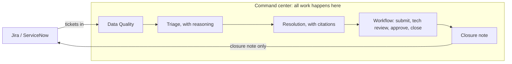

# Meeting takeaways: 19 Nov 2026, AI-based command center review

**Present:** Vinay, Bhim, Imran, Alan.
**What happened:** Vinay demoed a production Operations Command Center (OCC) built for ServiceNow and used it as the model for our console. He also reviewed our console directly.
**Deadline:** client demo in the week of 23 Nov 2026.

Code state when this was written: `dev` at `86b29c8` (18 Nov), so nothing below is built yet unless marked.

## The main message

We are building three agents. The client is buying a **command center**. Everything an AMS engineer does on a ticket should happen in our console.

> "You are thinking only from these three agents' perspective. That's not the end goal. All the AMS process should be in command center."

## What we have to do

| # | Ask | Detail | Status |
|---|---|---|---|
| 1 | Full flow inside the console | Jira and ServiceNow are the source and the destination only. Tickets come in at the start, the closure note goes back at the end. Never switch to Jira during the demo. Our engineer home page has "Open in Jira" as its main button: remove that jump. | Do first |
| 2 | Workflow trail on each ticket | Who did what, in order: submitted for technical review, approved by tech lead, closed by incident manager. Plus the closure note. | Partly there |
| 3 | Realistic demo tickets | Word them like real incidents of that application, for example "insurance payment didn't go through for deal 11111". Numbers can be fake. Random tickets "will not click" with the client. | Do first |
| 4 | Story deck | Problem (scattered knowledge, data quality, ticket hygiene and aging) → what happens today → the agents that help → other features → AI capabilities used. | After 1 and 3 |
| 5 | Show outputs, not mechanics | "It shouldn't matter to them how they did it, just show them the DQ output." | Applies to the demo script |

## Target flow

Only the closure note is written back. "We are not updating to and fro."

## Design of the reference app

Use this as the pattern for our console. Described from the screens shown; no screenshots are stored in this repo.

### Look
- Red and white, taken from the client's public website. Deep red gradient for the login backdrop and brand panel, white content cards on a pale grey page.
- Thin red rule under the top bar. Red filled pills for the selected filter and for primary buttons.
- Priority shown as small coloured pills: green Low, amber Medium, orange/red High.

### Login
- Two-panel card. Left: product name, the tagline "Clarity. Intelligence. Command.", and a small hub diagram (Knowledge, Incidents, Insights, Resolution around a central intelligence node).
- Right: three steps (Identify, Verify, Personalise). The user picks a **working role** (Administrator or Support Engineer) and enters a PIN.

### App shell
- Top bar: logo and product name on the left, user name in the middle, Help, Report Issue, a role badge and Logout on the right.
- Left sidebar, in this order: Ask a Query, My Tasks, Tickets & Feedback, Incident Details, LogAnalyzer, Problem Records. Recent queries are listed under it.

### Incident dashboard
- Seven count tiles in one row: Total, In Progress, Assigned, Resolved, Closed, High Priority, Processed External.
- Filter row: search box, category (application) dropdown, status pills (All, In Progress, New, Assigned, Closed, Processed External), age pills (under 7 days, 7–30, 30–90, 90 days–6 months, over 6 months).
- A red banner for data quality: incidents with missing required fields are highlighted in red, and the requestor has already been asked for the information.
- Tickets are cards in a five-column grid. Each card: incident number, priority badge, two-line summary, type, impact pill, status, time in queue with its age bucket.
- Picking one application cut 122 tickets to 5. That is the view a single-application engineer works from.

### Ticket page
- Incident data.
- AI recommendation: root cause plus citations.
- Triage details **with the reason**, for example why a ticket is Medium.
- Data completeness status (completed / passed).
- Closure notes, ready to send to the source system.
- Workflow Actions and review comments: the trail in ask 2.

### Other screens
- **Ask a Query:** one assistant over business rules, incident history and knowledge docs. Empty state says "Ask me anything", history counter top right.
- **LogAnalyzer:** choose the application, describe what you are seeing, optionally compare pre-production and post-production logs for new errors, choose full file or a time window, upload logs. PII is masked before any AI processing and files are processed in memory only.
- **My Tasks, Tickets & Feedback, Problem Records.**
- **Source sync:** a bookmarklet pulls a record from ServiceNow by type and number, with a minimal preview, so the source system is left untouched.

### Story deck shown
"Every Incident Carries Knowledge". Before: knowledge spread over SharePoint, KB articles, SMEs, past tickets and requirement documents. With the command center: incident → unified intelligence → guided response.

## What this means for our console

- Remove "Open in Jira" as the primary action on the engineer home page; keep the engineer on our ticket page.
- Show the triage reason next to the priority.
- Put the closure note and the workflow trail on the ticket page, and send only the closure note back to Jira.
- Filter the queue by application so an engineer sees only their own tickets.
- Reseed the demo with realistic, domain-worded tickets.
- Later, beyond the three agents: log analysis, a single query assistant, problem records.

## Order of work

1. Full flow in the console (ask 1).
2. Realistic demo tickets (ask 3).
3. Workflow trail and closure note on the ticket page (ask 2).
4. Story deck (ask 4).
